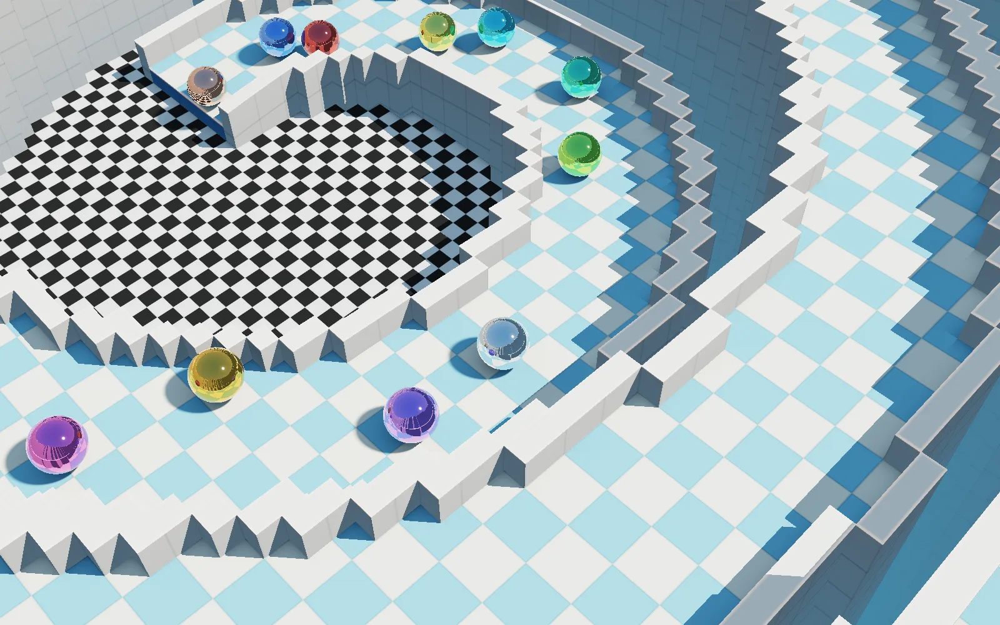

<p align="center"></p>

<h1 align="center">Marble Mist</h1>

<p align="center"><b>Race ten marbles down floating obstacle courses, right in your browser.</b><br>
<a href="https://nearbycoder.github.io/marble-mist/play/"><b>Play now</b></a> ·
<a href="https://nearbycoder.github.io/marble-mist/">Website</a></p>



A downhill marble race in the spirit of the old isometric marble games: you (the chrome marble) against ten AI marbles,
rolling down raised obstacle courses that float over a void. Ramps, step drops, funnels and catwalks with no rails,
bumpers, spinning bars, pushers, stompers, ice and boost pads. Roll off an edge and you respawn at the last checkpoint;
drop too far and the marble shatters.

## Courses

44 courses across four difficulty levels. Seven are hand-built:

| Course | Look | What's on it |
|---|---|---|
| Sunny Steps | Daylight | Wide railed ramps, a few bumpers, one slow spinner |
| Pinball Terraces | Sunset | Bumper fields, spinners, a pusher, a narrow funnel |
| Roundabout | Candy | Round platforms swept by giant spinners, banked hairpins |
| Mistfall | Moonlit, foggy | Catwalks above a sea of fog the marbles push around, pushers, stompers, ice |
| Maelstrom | Ocean | Banked curves, a funnel bowl, then three laps down a spiral pit to a finish at the bottom |
| Corkscrew | Sunset | Banked hairpin after hairpin, narrowing, into a two-lap spiral pit |
| The Gauntlet | Neon | Steep funnels, ice, jumps over the void, stompers, a two-wide catwalk |

The other 37 are laid out by a seeded generator. It strings together course sections, weighted differently for each
course: ramps, terrace drops, bumper fields, spinners, pushers, stomper alleys, catwalks, ice, boost pads, jumps,
staircases, zigzags, switchbacks, banked curves, hairpin sweeps, funnel bowls (a cone that drains into an exit
channel) and round platforms. Some end in a spiral pit instead of a finish straight. Each course also has its own theme
(13 in all), difficulty, length (200–600 m) and, for seven of them, fog. Layouts that would cross themselves are
rejected and re-rolled. Every course has its own fixed seed, so it is the same every time.

## How it plays

When walls hide your marble (down in a pit or a channel), the camera tilts to look more steeply down.

**Performance.** The game finds your display's refresh rate (60, 120 Hz and so on), reads the GPU's time per frame, and
renders as many pixels as fit that budget. That means native resolution when there is headroom, less when there is not,
and on fog courses, fewer fog steps as a last resort. The stats line at the bottom right shows the resolution, fps,
target refresh rate and GPU time. Fog is drawn at half resolution and blended back in with a depth-aware upsample. The
fog simulation runs at a fixed 60 Hz in 11 passes per step.

- **Drag** away from your marble to roll that way (further = faster), or use **WASD** / arrows in screen directions
- **Scroll** to zoom, **Esc** to pause
- **Controllers** (any standard-mapping gamepad: Xbox, PlayStation, Switch Pro and similar):
  - The left stick or D-pad rolls in screen directions; it's analog, so a half push gives half the thrust.
  - The right stick zooms, and Start pauses.
  - The controller rumbles when you fall or hit a bumper.
  - In menus, the D-pad or stick moves a focus ring. A selects, B goes back, and Start is each screen's main action
    (race, place the bet, resume, race again).
  - In bet mode, LB / RB switch which marble the camera follows.
- **Rivals** on the menu sets how good the AI marbles are. On Normal and Hard they drive faster than the safe racing
  line, and marbles ahead of you never slow down to let you catch up
- **Bet mode** (Mode → Bet): you don't steer. Pick a marble and bet coins on it to win, or to finish in the top three.
  Odds come from each marble's hidden skill (the Form bar), with a 10% house edge. You start with 100 coins, kept in
  this browser; if you run out, the house gives you another 100. During the race, **Tab** or a click on the standings
  switches which marble the camera follows
- **Settings** (from the main menu or the pause menu), saved in this browser:
  - **Audio:** master, music, sound effects and interface volume, and muting in the background.
  - **Video:** resolution (Auto or fixed), a 60 fps cap, sun shadows, fog quality, brightness and camera distance. The
    fog look sliders and the fog map are here too.
  - **Interface:** name tags (all, mine or off), the minimap, standings, control hints and performance stats.
  - **Controls:** a reference card, stick dead zone and rumble.
- **Sound** is synthesised live with Web Audio; there are no audio files. It covers rolling, collisions, bumpers,
  stompers, falls and the countdown, plus generative music in a key that matches each course's theme: calm in menus,
  with drums during a race. Browsers only start sound after a click or a key press.
- Testing aids (append to the game URL): `?scale=N` fixes the render scale, `?auto` lets your marble drive itself, `?course=N` picks course N (1–44, in menu order), `?speed=N` runs the simulation N× faster

## Running it locally

The game is one self-contained file, `play/index.html`, with no build step and no dependencies. Open it in a browser
with WebGL2, or serve the folder so the marketing page and game links work together:

```sh
python3 -m http.server 8000
# then open http://localhost:8000/ (site) or http://localhost:8000/play/ (game)
```

## Repository layout

| Path | What it is |
|---|---|
| `index.html` | The marketing site (GitHub Pages serves it at the site root) |
| `play/index.html` | The whole game: renderer, physics, AI, courses, audio and UI |
| `media/` | Gameplay video and screenshots used by the site and this README |
| `assets/` | Icon and social-share image |

## License

[MIT](LICENSE). Created in [T3 Code](https://t3.codes).
